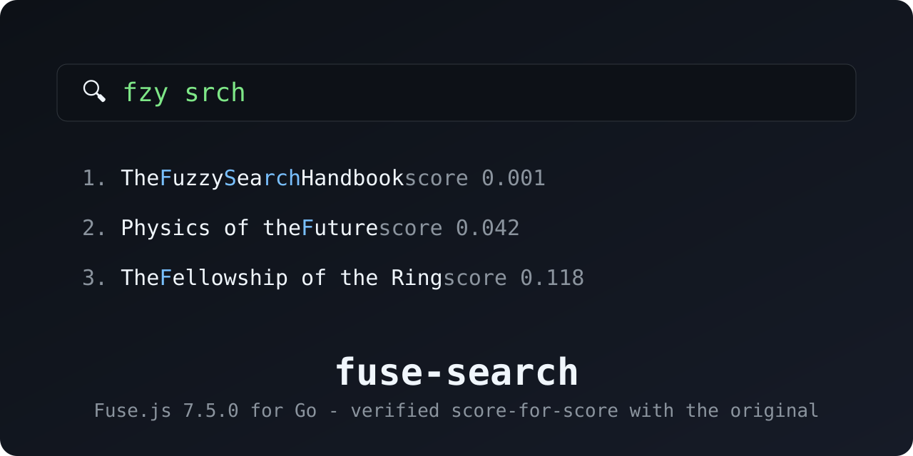

<div align="center">
  
  <h1>fuse-search</h1>
  <p><strong>Fuse.js for Go: the fuzzy search your JS frontend already ships, verified score-for-score against the original.</strong></p>
  <p>
    <a href="https://github.com/ofershap/fuse-search/actions"></a>
    <a href="https://pkg.go.dev/github.com/ofershap/fuse-search"></a>
    <a href="LICENSE"></a>
  </p>
</div>

[Fuse.js](https://fusejs.io) is the de-facto standard for client-side fuzzy search (about 19M npm downloads/week as of November 2026). When the same product has a Go backend, the usual options are a rewrite that scores differently, a heavyweight search server, or shipping everything to the client. fuse-search is a line-by-line port of the Fuse.js 7.5.0 engine, verified against the npm package on a pinned differential corpus: same scores, same match ranges, same ordering, on every case tested (see [Verified against the original](#verified-against-the-original-not-just-inspired-by-it) for exactly what that covers, and [Known boundaries](#known-boundaries-by-design) for what it does not).

```bash
go get github.com/ofershap/fuse-search
```

```go
package main

import (
	"fmt"

	fuse "github.com/ofershap/fuse-search"
)

type book struct {
	Title  string `json:"title"`
	Author struct {
		LastName string `json:"lastName"`
	} `json:"author"`
}

func main() {
	books := []any{
		book{Title: "Old Man's War"},
		book{Title: "The Lock Artist"},
	}

	f, err := fuse.New(books, &fuse.Options{
		Keys:         []any{"title", fuse.Key{Name: "author.lastName", Weight: 2}},
		IncludeScore: fuse.Bool(true),
	}, nil)
	if err != nil {
		panic(err)
	}

	results, _ := f.Search("old man", nil)
	for _, r := range results {
		fmt.Printf("%s (score %.3f)\n", r.Item.(book).Title, *r.Score)
	}
}
```

Works on slices of strings, maps (`map[string]any`, JSON-shaped), or structs (field names and `json` tags). Zero dependencies; module floor is Go 1.22.

## What you get

The full Fuse.js 7.5.0 option and feature surface of the npm `fuse.js` build (not `fuse.js/basic`), with parity verified on the corpus described below:

- **Fuzzy search** - the Bitap algorithm with `location`, `threshold`, `distance`, `ignoreLocation`, `findAllMatches`, `minMatchCharLength`.
- **Weighted keys** - per-key weights, normalized exactly like fuse.js, including nested dotted paths (`author.lastName`) and array values.
- **Extended search** - `=exact`, `'include`, `^prefix`, `suffix$`, `!inverse`, quoted multi-word terms, `|` OR groups, escaped `\|`.
- **Logical queries** - `$and` / `$or` trees, keyless leaves, `$path`/`$val` entries.
- **Token search** - `useTokenSearch` with TF-IDF weighting and `tokenMatch: "any" | "all"`.
- **Mutation and persistence** - `Add`, `Remove`, `RemoveAt`, `SetCollection`, plus `CreateIndex` / `MarshalIndex` / `ParseIndex` for serializing a built index (same JSON shape as `FuseIndex.toJSON()`).
- **One-shot compare** - `fuse.Match(pattern, text, opts)` (token search rejected, as in fuse.js).

All 20 fuse.js 7.5.0 options are supported with the same defaults (`IsCaseSensitive`, `IgnoreDiacritics`, `IncludeScore`, `Keys`, `ShouldSort`, `SortFn`, `IncludeMatches`, `FindAllMatches`, `MinMatchCharLength`, `Location`, `Threshold`, `Distance`, `UseExtendedSearch`, `UseTokenSearch`, `Tokenize`, `TokenMatch`, `GetFn`, `IgnoreLocation`, `IgnoreFieldNorm`, `FieldNormWeight`). Pointer fields mirror the JS "unset vs explicit" distinction; `fuse.Bool`, `fuse.Int`, and `fuse.Float64` build them.

## Verified against the original, not just inspired by it

Every merged change runs a differential suite (`go test ./...`) against fixtures generated by the pinned npm package:

- **113 golden cases + 3 mutation sequences + an index roundtrip**, generated by `fuse.js@7.5.0` (committed lockfile, `testdata/gen/`), comparing items, ordering, scores, and match indices with exact `float64` equality - no tolerance. An additional corpus pins extended-search edge patterns (empty-capture tokens like `'`, `=`, `""`, `^`, `!`), where fuse.js's own truthiness rules decide which matcher runs.
- **Index interchange in both directions.** An index serialized by fuse.js (`FuseIndex.toJSON()`) is parsed by this package and reproduces fuse.js's own search results bit-exact; an index marshaled by this package is semantically identical to the one fuse.js builds over the same input and is consumed by `Fuse.parseIndex` in Node (`testdata/gen/verify_index_from_go.mjs`).
- **Number formatting matches `String(number)`** across the boundary magnitudes (1e-8 through 1e22, negative and fractional values), verified against Node output in `testdata/gen/numeric_format.json`.
- Scores route through faithful ports of the fdlibm `pow`/`log` routines V8 actually executes (`jsfdlibm.go`), because Go's `math.Pow` can differ from V8 by 1 ulp. Verified bit-exact against Node 22 over 102,000 domain points during development.
- Unicode fidelity: match indices are UTF-16 code-unit offsets, exactly what fuse.js reports (JavaScript counts in code units, so a matched emoji costs 2). Lowercasing follows JS `toLowerCase`, not Go's `unicode.ToLower` (56 runes differ, e.g. `İ`); diacritics stripping replicates fuse.js's NFD + combining-mark removal (14,521 generated mappings).
- A fuzz target (`FuzzSearch`) hammers all search modes; CI runs it for 30s on every push. The module floor is verified on the real Go 1.22.0 toolchain.

This is what "verified" means here: exact equality against the pinned reference on the corpus above. It is strong evidence of fidelity, not a proof of universal equivalence for every possible input - that is why the corpus is committed and the generator is runnable (`cd testdata/gen && npm ci && node gen.js`).

### Known boundaries (by design)

- `GetFn`, `SortFn`, and a custom `Tokenize` are Go functions - they cannot be shared with a JS runtime the way static options can.
- Key extraction stringifies numbers as JS `String(number)` does, verified on the boundary fixture above. Go `int64`/`uint64` values beyond 2^53 keep their exact digits, where JavaScript would already have rounded them at parse time.
- Index JSON is schema-compatible with `FuseIndex.toJSON()` and crosses the JS/Go boundary in both directions (verified as described above); function-valued keys (`getFn` in a `Key`) are excluded from serialization, as in fuse.js.

## Performance

Median of 25 timed runs (3 warmups) per workload, 2,000 documents (title + weighted author key), same corpus and options, same machine (November 2026). Lower is better; treat as orientation, not a contract.

| Workload                     | fuse-search | fusego (2026-11-14) | fuse.js 7.5.0 (Node 22) |
| ---------------------------- | ----------- | ------------------- | ----------------------- |
| Index build                  | 2.7 ms      | 3.2 ms              | 1.3 ms                  |
| Search, hit ("old man")      | 9.6 ms      | 6.1 ms              | 10.4 ms                 |
| Search, miss ("zzzqqx")      | 6.6 ms      | 2.8 ms              | 7.7 ms                  |
| Search, short pattern ("go") | 7.0 ms      | 11.3 ms             | 5.5 ms                  |

No implementation wins across the board; choose on fidelity, packaging, and dependencies rather than speed. fuse-search was measured over `map[string]any` docs, fusego over typed structs (its native shape). Reproduce: `go test -bench . -run '^$'` for fuse-search, and `node testdata/gen/bench_mirror.mjs` for the fuse.js mirror.

## Alternatives in the Go ecosystem

- **[lithammer/fuzzysearch](https://github.com/lithammer/fuzzysearch)** - simple Levenshtein ranking; no weighted keys, Bitap scoring, extended syntax, or index persistence.
- **[bleve](https://github.com/blevesearch/bleve)** - a full-text search server library; the right tool when you need indexing pipelines and analysis, much heavier than an embedded fuzzy matcher.
- **[itzTheMeow/fusego](https://github.com/itzTheMeow/fusego)** - a feature-complete Fuse.js port (20/20 options, verified here). Verified facts as of 2026-11-14: the install command in its README fails as written (reproduced: "malformed module path"), it requires Go 1.26+, depends on `golang.org/x/text`, and has no tagged releases. Its canonical module lives at `forge.xela.codes/xela/fusego` with the GitHub repo as a mirror. fuse-search exists to be the boring, dependable distribution: a `github.com` module path, zero dependencies, Go 1.22+ floor, semver tags, and a golden corpus you can regenerate and inspect without a Node bridge.

<details>
<summary><strong>FAQ: fuzzy search in Go, Fuse.js parity, and when to use what</strong></summary>

**Is there a Go version of Fuse.js?**
Yes - fuse-search ports the Fuse.js 7.5.0 engine to Go with zero dependencies. Results, scores, and match indices are verified bit-exact against the npm package on a differential corpus.

**How do I fuzzy-search a slice in Go without a search server?**
`go get github.com/ofershap/fuse-search`, build a `fuse.New(docs, &fuse.Options{Keys: ...}, nil)`, and call `Search`. Everything runs in-process; no Elasticsearch, no sidecar.

**Can my Go backend return the same ranking as my fuse.js frontend?**
That is the point of this package. fuse-search reproduces fuse.js scoring exactly (including its UTF-16 match indices and JS-specific lowercasing), so a query typed in the browser and re-run on your Go API returns the same order and scores.

**Does fuse-search support weighted fields and nested keys?**
Yes: `fuse.Key{Name: "author.lastName", Weight: 2}` over maps or structs, with weights normalized exactly like fuse.js.

**Fuzzy search vs full-text search (bleve) in Go - which do I need?**
Fuzzy search (fuse-search) tolerates typos and partial matches over in-memory collections up to roughly tens of thousands of small docs. Full-text engines index large corpora on disk with analyzers, stemming, and BM25. If you are already reaching for fuse.js semantics, you want the former.

**What about case folding and accents?**
`IgnoreDiacritics` strips accents the way fuse.js does (NFD + combining-mark removal plus its explicit non-decomposable map), and case folding follows JavaScript `toLowerCase`, including the runes where it differs from Go's.

</details>

---

Part of the [gitshow.dev](https://gitshow.dev) Go toolbox - [gailwind](https://github.com/ofershap/gailwind) · [lather](https://github.com/ofershap/lather) · [json5](https://github.com/ofershap/json5) · [poppy-go](https://github.com/ofershap/poppy-go) · [cron-utils](https://github.com/ofershap/cron-utils) · [handlebars-go](https://github.com/ofershap/handlebars-go) · [fxp-go](https://github.com/ofershap/fxp-go)

Apache-2.0 © 2026 Ofer Shapira. See [NOTICE](NOTICE) for attribution to Fuse.js and fdlibm. Built with the README Builder.
